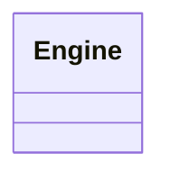

# link-diagram-tasks

Connect TDD tasks to existing Mermaid class nodes so the project preview can show
implementation progress without manually mapping every task. The tool matches a
C# filename in a TDD task row or baseline list to an explicit `class` declaration
in a registered class diagram. It reports exact matches in a dry run by default.
`--apply` updates `state.json` in one revision-checked operation. It preserves
existing links and statuses and never edits the diagram.

```bash
bash Tools/link-diagram-tasks/link-diagram-tasks.sh path/to/Feature
bash Tools/link-diagram-tasks/link-diagram-tasks.sh path/to/Feature --apply
```

## Before and after

Suppose `state.json` registers `Example_TDD.md` as `tdd` and `Architecture.mmd`
as `concrete_class_diagram`. The TDD has these task rows:

```markdown
| T1 | Implement `Engine.cs` | done |
| T2 | Verify `Engine.cs` | todo |
```

`Architecture.mmd` already contains:



Before the command, the two tasks have `status: done` and `status: todo` and
neither has `diagram_nodes`. The dry run prints:

```text
T1  concrete_class_diagram  Engine
T2  concrete_class_diagram  Engine
Dry run. Use --apply to update 2 tasks.
```

After `--apply`, the relevant `state.json` fields are:

```json
{
  "artifact_roles": {
    "tdd": "Example_TDD.md",
    "concrete_class_diagram": "Architecture.mmd"
  },
  "tasks": [
    {"id": "T1", "status": "done", "diagram_nodes": {"concrete_class_diagram": ["Engine"]}},
    {"id": "T2", "status": "todo", "diagram_nodes": {"concrete_class_diagram": ["Engine"]}}
  ]
}
```

The preview counts one done task out of two linked tasks and displays **50%**
on the `Engine` node. `Architecture.mmd` is unchanged. To link a task that the
TDD does not associate with a matching filename, use `feature-state task`.
