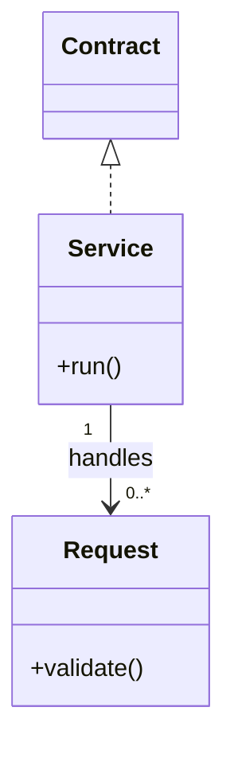

# Mermaid class graph editor

Open an existing UTF-8 Mermaid class diagram in a local browser. Install Python 3.9 or later. The browser loads Cytoscape 3.30.2 from cdnjs, using the same version as the code graph. If the library is unavailable, you can still edit and save the source.

```bash
Tools/mermaid-graph/mermaid-graph.sh start path/to/architecture.mmd
Tools/mermaid-graph/mermaid-graph.sh list
Tools/mermaid-graph/mermaid-graph.sh stop path/to/architecture.mmd
```

Open the printed URL. You can also stop an editor by passing its PID or URL from `list`. Starting the same canonical path again returns its running URL. Separate files get separate loopback servers. The per-user registry and logs live under `~/.mermaid-graph/`.

## Generate from C# source

```bash
bash Tools/mermaid-graph/mermaid-graph.sh generate path/to/source path/to/diagram.mmd
```

Pass an existing output directory to name the diagram after the source directory and the UTC date, for example `AgentSDK_27_11_26.mmd`. For an explicit file path, create its parent directory first. The command prints the output path and refuses to overwrite an existing file.

The generator scans C# declarations recursively and merges partial types. Relationships are inferred from declarations within the scan. Resolution uses qualified names, enclosing scopes, and unique simple names. The C# parser does not evaluate imports or conditional compilation.

## Editing

- Drag the background to pan, scroll to zoom, drag classes to reposition them, and use **Fit** to frame the graph. Manual positions last for the current page session.
- Use **Nodes**, **Details**, and **Source** to show or hide each panel independently. Search by node name and press Enter or choose a matching node.
- Select a node and click **Focus selected**, or double-click a node. **Depth** controls how many relationship hops to show in either direction. **Full graph** restores all nodes.
- Use **Relationship types** to toggle each kind independently. For example, leave only **Inheritance** checked to inspect base and derived classes. In the full graph, the toggles apply to edges connected to the selected node. In focus mode, only enabled types count toward **Depth**. The choices apply for the current page session.
- Choose a relationship type and direction, turn on **Draw relationship**, then drag from the left endpoint to the right endpoint. You can also select the left endpoint and drag another node from the **Nodes** panel into the workspace. Both gestures add a relationship to the draft. Use **Add relationship** for the form, including label and multiplicities.
- **Add node** supports classes, interfaces, structs, and enums. Use **Details** to rename or delete a node or to edit or remove a relationship. Deleting a node removes the attached relationships listed in the confirmation.
- Edit fields and methods in **Mermaid source**. **Save** writes the entire draft to the selected file. If the file changed on disk, the editor keeps your draft in the source pane. Copy the draft before reloading, then merge it with the disk version.

## Supported syntax

Simple class IDs use ASCII letters, digits, and underscores and start with a letter or underscore. Declare classes with `class Name`, a multiline `class Name { … }` block, or an empty `class Name {}` block. Use `Name : member` for single-line members. Relationship endpoints can introduce classes implicitly.

Use `<<interface>>`, `<<struct>>`, or `<<enumeration>>` as a type annotation. The editor also recognizes `<<enum>>`. Put the annotation in a class block or on its own line before the class ID. Interfaces use green tags, structs use orange rectangles, and enums use yellow rectangles.

| Relationship | Marker at the left | Marker at the right |
| --- | --- | --- |
| Inheritance | `<\|--` | `--\|>` |
| Realization | `<\|..` | `..\|>` |
| Composition | `*--` | `--*` |
| Aggregation | `o--` | `--o` |
| Association | `<--` | `-->` |
| Dependency | `<..` | `..>` |



Visual edits preserve unrelated lines and whole-line comments. Syntax outside the editable subset, such as namespaces, directives, display aliases, or generic class declarations, produces line-numbered warnings and disables visual edits. You can use the source pane to edit and save those diagrams.

## Checks

```bash
python3 -B -m unittest discover -s Tools/mermaid-graph/tests
```

The integration check starts loopback servers and uses a temporary registry and diagram files.
